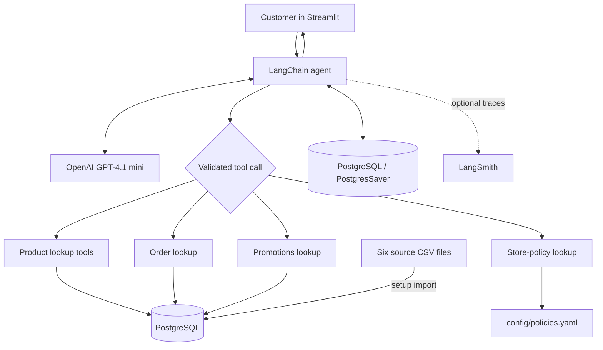

# Empório da Música: AI Customer Support Agent

A Python customer support agent built for Artefact's AI Engineer technical challenge, using **LangChain, LangGraph, OpenAI, PostgreSQL, and Streamlit**. It simulates the support experience of Empório da Música, a fictional musical instrument store based in Campo Grande, Brazil.

**The central idea is to make the challenge dataset an interactive test environment.** Evaluators can choose an existing fictional customer, act as that person, and contact the assistant about products, orders, shipping, promotions, returns, and store policies. Because the customer, order, product, and promotion records come from the supplied challenge data, evaluators can check the agent's claims against the original CSVs. The policy PDF serves as the reference for business rules.

Rather than letting the language model invent operational facts, the agent **selects purpose-built tools** that query the imported data or retrieve structured policies.

> **Scope:** This is a local, read-only **demonstration**, not a production commerce or identity-management system. All customer profiles are selectable without authentication and should be treated as fictional test data.

## Quick start

### Prerequisites

- **Docker Engine / Docker Desktop** running, with the **Docker Compose** plugin (`docker compose`).
- **[uv](https://docs.astral.sh/uv/)** installed. `uv` manages the Python environment and dependencies from the project's lockfile.
- An **OpenAI API key** with API access and available usage credits. ChatGPT subscriptions do not automatically include API credits.
- Internet access on first run to obtain Python packages, the PostgreSQL container image, and to call the OpenAI API.

The setup process is designed for **Windows, macOS, and Linux**. You do not need to install PostgreSQL locally or create a database manually.

### Install and run

```bash
git clone https://github.com/ayrtonbezerra/emporio-musica-ai-agent.git
cd emporio-musica-ai-agent
uv run python scripts/setup.py
```

The installer will:

1. Check for the required application, SQL, and dataset files.
2. Create or reuse a local `.env` file, prompting for your **OpenAI API key**.
3. Optionally ask whether to enable **LangSmith tracing**, along with an API key and project name.
4. Check Docker, choose a local PostgreSQL port, and start a **PostgreSQL 17** container using Docker Compose.
5. Create the application tables from `sql/001_create_tables.sql`.
6. Load the six supplied CSV datasets using `scripts/load_data.py` when the database is empty.
7. Initialize the **LangGraph PostgresSaver** checkpoint tables, then launch Streamlit.

Open **http://localhost:8501** (or the address printed by Streamlit). Choose a fictional customer from the sidebar to start testing. The sidebar shows the selected customer's order IDs so you can ask about records that actually exist. See [How the demonstration works](#how-the-demonstration-works) for a suggested evaluation flow.

**LangSmith is optional:** decline tracing if you do not have a LangSmith account. The agent still works without it. If you enable tracing, you can enter a project name during setup; traces appear after the first instrumented requests.

### Start the app again

After the initial setup, run:

```bash
uv run streamlit run src/emporio/app.py
```

If the Docker container is stopped, start it first:

```bash
docker compose up -d --wait
```

Running `uv run python scripts/setup.py` again is also supported: it reuses the existing environment and populated database rather than intentionally resetting customer data or chat history.

To stop the app, press `Ctrl+C` in its terminal. To stop the database, run `docker compose down` (**without** `-v`; deleting volumes would erase stored data and conversations).

### Configuration and secrets

The installer creates `.env` with connection details and credentials. The important settings are:

| Variable | Purpose |
| --- | --- |
| `OPENAI_API_KEY` | **Required** API credential for the language model. |
| `DATABASE_URL` | PostgreSQL connection string used by the application and persistence layer. |
| `POSTGRES_USER`, `POSTGRES_PASSWORD`, `POSTGRES_DB` | Local database container credentials. |
| `POSTGRES_PORT` | Host port for PostgreSQL, selected during initial setup. |
| `COMPOSE_PROJECT_NAME` | Separates this demo's Docker resources from other Compose projects. |
| `LANGSMITH_TRACING` | Enables or disables tracing. |
| `LANGSMITH_API_KEY`, `LANGSMITH_PROJECT` | Optional tracing credential and project name. |

**Never commit `.env`, API keys, or database passwords.** The installer saves secrets in the local `.env` file; it does not implement a production secrets manager.

## How the demonstration works

This is not an empty chatbot that requires evaluators to invent customers or transactions. The application is designed around the **mock operational data supplied with the technical challenge**. Its purpose is to let a reviewer reproduce realistic interactions while retaining a concrete reference for checking the answers.

1. **Choose a customer profile.** The Streamlit sidebar lists the fictional customers imported from `data/desafio_tecnico_ai_eng - customers.csv`. Selecting a profile lets the evaluator act as that customer without creating an account or entering a password.
2. **Use the customer's existing orders.** The sidebar displays order IDs associated with the selected customer. The evaluator can ask about order status, delivery details, or the store's return process using records already present in the case.
3. **Simulate different support situations.** Ask the agent to recommend an instrument within a budget, explain a product's specifications, check a promotion, locate an order, or apply the rules for defective goods. The agent chooses the appropriate tools according to each request.
4. **Compare responses with the challenge materials.** The original CSV files act as the **reference data for operational answers**, including prices, stock levels, product details, order records, and promotions. `data/políticas_da_loja.pdf`, represented in the application by the reviewed `config/policies.yaml`, is the reference for commercial policies. This makes it possible to check whether the agent selected the right tool, used the correct record, and interpreted the policy accurately.
5. **Switch profiles to test conversation separation.** Each fictional customer has a distinct persistent conversation. Change profiles, interact with the agent, then switch back. The previous customer's conversation should still be available, including after restarting Streamlit.

For example, a reviewer can select a customer with an existing order, ask whether a defective instrument can be returned, supply the order number when requested, and verify both the order facts and the policy guidance against the provided files. They can then select a different customer to test another situation without mixing the two histories.

The source datasets are a **reference for manual verification**, not an automatically scored benchmark. A plausible response is not necessarily a correct one; the evaluator should compare the factual details to the relevant source records. The application does not execute returns, refunds, or changes to customer records.

**Demonstration only:** Customer selection deliberately bypasses authentication to make the review process quick. It is appropriate for fictional case data, not for a production system containing private customer information.

## What the agent can do

| Capability | Implementation | Example |
| --- | --- | --- |
| Search the catalog | `search_products` queries the product catalog with structured filters | “Which acoustic guitars cost up to R$1,000?” |
| Inspect a product | `get_product_details` retrieves a specific product's details | “Tell me more about that first model.” |
| Check an order | `get_order_details` retrieves order information from the operational database | “What is the status of order 12?” |
| Check active offers | `get_promotions` retrieves promotional records | “Are there any active discounts on guitars?” |
| Explain store rules | `get_store_policy` looks up a topic in the structured policy file | “Can I return an instrument with a defect?” |

The agent can combine tool results across multiple turns and remember earlier references, such as “the second instrument” or “that order,” within the selected customer's conversation.

It **cannot** place orders, charge customers, process refunds, cancel purchases, modify inventory, create support tickets, or actually approve returns. It only provides information and guidance supported by the data and available tools.

## Architecture



**Request lifecycle:** The user submits a message in Streamlit; the application invokes the agent with the customer's conversation thread; the LLM decides whether a tool is necessary and prepares its arguments; Pydantic schemas validate those arguments; application-owned tools query PostgreSQL or the policies YAML; the LLM formulates an answer using the retrieved results; LangGraph persists the thread state in PostgreSQL. LangSmith can capture the execution trace when enabled.

### Why this architecture?

| Decision | Rationale and trade-off |
| --- | --- |
| **Python** | The required language for the challenge and a natural fit for LLM orchestration, validation, database access, and a simple web UI. |
| **LangChain's `create_agent` and LangGraph runtime** | LangChain provides established abstractions for agent execution, model integration, tool registration, and tool calling. `create_agent` is built on LangGraph, so the project can use checkpointing and multi-turn state without building an orchestration engine from scratch. That shortened implementation time while keeping the workflow inspectable and extensible. The goal was a reliable single-agent support flow, not a custom graph or multi-agent system for its own sake. |
| **Pydantic integration and tool error recovery** | LangChain tools support Pydantic `args_schema` models directly, allowing explicit types, allowed values, and field constraints before repository queries run. The project also uses structured tool errors to distinguish invalid categories or topics, missing records, and infrastructure failures. This integration was an important reason for choosing the framework: validation and recovery fit the agent workflow without implementing custom argument parsing and exception handling for every tool call. |
| **OpenAI `gpt-4.1-mini`, temperature 0** | A compact model is a pragmatic choice for relatively constrained customer-support tasks, balancing responsiveness and API costs. Low temperature is intended to reduce output variability; it does **not** guarantee factual correctness. Model comparisons and cost/latency benchmarks remain future work. |
| **PostgreSQL for operational data** | Six related CSV datasets naturally map to relational tables. Foreign keys, typed columns, and parameterized queries help enforce data relationships and keep retrieval predictable. The database is a local snapshot, not a live store integration. |
| **Curated YAML for policy retrieval (not vector RAG)** | The supplied manual is small and organized into known subjects. A reviewed, topic-keyed YAML representation is easier to audit and more deterministic than adding embeddings, a vector database, and semantic chunk retrieval for a single policy document. The trade-off is manual synchronization when the PDF changes. |
| **LangGraph `PostgresSaver`** | LangGraph's checkpoint abstraction already supports conversation state persistence, avoiding a separate custom message-history service or conversation management tables. `PostgresSaver` stores checkpoints in the PostgreSQL instance used by the application. A deterministic `customer-{customer_id}` thread ID restores each fictional profile's conversation after profile switches or Streamlit restarts. This is thread separation for a demo, not authentication or ticket management. |
| **Streamlit** | A minimal browser interface lowers the effort required for evaluators to try the agent. It intentionally prioritizes agent functionality over production-grade UI, user management, and deployment infrastructure. |
| **Optional LangSmith** | Tracing makes the sequence of model/tool calls, their arguments, and failures inspectable during debugging and evaluation; it adds an external observability dependency only when explicitly enabled. |
| **Docker Compose + uv + one setup script** | A reproducible cross-platform local demo is easier to assess than manual dependency installation, PostgreSQL setup, and SQL/CSV initialization. The reviewer still needs Docker, uv, and an API key. |

### Tool execution and data boundaries

The **LLM decides when to call a tool, but it does not execute arbitrary SQL**. Database access lives in Python repositories and uses parameterized queries. Data is retrieved on demand instead of placing all customer and product records in the system prompt.

The application imports the challenge CSVs once into local PostgreSQL tables: `categories`, `customers`, `products`, `orders`, `order_items`, and `promotions`. The policy source is `config/policies.yaml`, a manually structured representation of `data/políticas_da_loja.pdf` with policy topics and provenance notes.

This separation gives each source a clear responsibility:

- **Database:** current values within the imported *snapshot* (prices, stock, order status, and promotion records).
- **YAML:** business rules (returns, warranties, payment terms, delivery rules, store hours, and related topics).
- **System prompt:** the agent's persona, scope boundaries, decision-making guidelines, tool-use instructions, and refusal/error-recovery behavior.

A policy describing an annual promotion is **not** proof that the promotion is currently active. Operational promotions must be checked through the relevant tool.

## Conversation memory and the demo UI

The sidebar lists the fictional customers from the original challenge data and exposes their existing order IDs. The interface is intentionally designed for a reviewer to **impersonate different fictional customers**, observe the agent's behavior, and verify answers directly against the supplied records. No signup or fabricated order creation is necessary.

Selecting a customer loads a stable LangGraph thread for that profile. Switching between customers changes the thread; switching back restores the earlier conversation. History remains available after restarting Streamlit because the checkpoints are stored in PostgreSQL, not only in Streamlit session state.

This design deliberately uses **one ongoing conversation per fictional customer**, rather than introducing tables and workflows for ticket creation, listing, and management. That is a simplification for demonstration purposes.

**Security caveat:** Selecting a customer profile is **not authentication**. Anyone with access to the demo interface can select another fictional profile and inspect its visible sample history. The application must not be deployed against real customer information without server-side identity verification, authorization on every private-data query, and access controls for conversation retrieval.

## Prompt design and handling uncertainty

The external system prompt lives in `prompts/system.md`; separating it from Python code makes its rules reviewable and versionable. Its main responsibilities are:

1. Keep the assistant within the Empório da Música customer-service scope. A pop-culture question is not a store-support request merely because the subject is related to music.
2. Maintain a friendly, lightly humorous tone for routine questions while prioritizing empathy and precision for complaints, defects, late orders, and returns.
3. Require authoritative tool results for prices, stock, promotion status, order details, and store policies.
4. Interpret natural language into the exact categories/topics/IDs expected by tools; ask clarifying questions when information is missing.
5. Handle structured errors such as invalid input, missing records, unavailable services, and unavailable customer context without exposing technical internals.
6. Avoid promising actions the system cannot perform, such as issuing a refund or filing a complaint.

### Policy ambiguity is preserved, not guessed away

The source policy manual contains business-rule ambiguities. For example, it distinguishes a **30-day defect-exchange process** from a **90-day legal warranty**. The agent should not conflate the two or deny a warranty claim merely because the shorter exchange period has elapsed. When a case depends on interpretation, the correct behavior is to explain the documented distinction and direct the customer to the human support channel.

The policy structure also records inconsistencies such as differing contact numbers and installment thresholds. Preserving these uncertainties is preferable to silently manufacturing one definitive rule.

**An LLM prompt is not a security boundary.** Rules for real users would need enforcement in application code and automated adversarial testing.

## Data and project layout

The six CSVs use the original source naming convention:

```text
data/desafio_tecnico_ai_eng - categories.csv
data/desafio_tecnico_ai_eng - customers.csv
data/desafio_tecnico_ai_eng - products.csv
data/desafio_tecnico_ai_eng - orders.csv
data/desafio_tecnico_ai_eng - order_items.csv
data/desafio_tecnico_ai_eng - promotions.csv
```

The installation process uses these actual filenames. The case data is imported into an isolated local database and does not contact any real retailer's back office.

```text
.
├── compose.yaml
├── config/
│   └── policies.yaml
├── data/
│   └── desafio_tecnico_ai_eng - *.csv
├── prompts/
│   └── system.md
├── scripts/
│   ├── setup.py
│   └── load_data.py
├── sql/
│   └── 001_create_tables.sql
├── src/
│   └── emporio/
│       ├── app.py
│       ├── agent.py
│       ├── database.py
│       ├── repositories/
│       ├── schemas/
│       └── tools/
├── pyproject.toml
└── uv.lock
```

The database loader expects the CSV columns to match the SQL schema. If a source file or schema changes, the import process should be reviewed rather than silently coercing unknown fields.

## Troubleshooting

- **Docker unavailable:** Start Docker Desktop or the Docker Engine, then confirm `docker compose version` and `docker info` work.
- **No customer profiles shown:** The setup did not load the CSV data into the selected database. Rerun `uv run python scripts/setup.py` and check its output; do not invent substitute filenames. If the database is partially populated, inspect it before resetting anything.
- **OpenAI request fails:** Check `OPENAI_API_KEY`, API billing/access, and network connectivity. A ChatGPT subscription is separate from API billing.
- **Port already occupied:** On a new setup, the installer chooses a free PostgreSQL port. If reusing an existing `.env`, inspect `POSTGRES_PORT` and the associated Compose project before modifying either.
- **LangSmith traces missing:** Tracing is optional. Check that `LANGSMITH_TRACING=true` and that the API key/project settings are correct. A new trace requires an actual agent invocation.

## How to evaluate the agent

The following scenarios exercise different paths and are good candidates for the **3 to 5 real conversation transcripts** required for this submission. Use the original CSVs and policy PDF to verify the responses. Save actual messages and responses as `.md` or `.txt` files in `examples/`; do not substitute hypothetical outputs for executed runs.

| Scenario | Suggested prompt | What to inspect |
| --- | --- | --- |
| Catalog search and filtering | “Which acoustic guitars do you have for up to R$1,000?” | Product-search tool selection, category/price filtering, available products only. |
| Product detail and follow-up context | “Tell me more about the first option.” | Reference resolution from the previous answer and product details. |
| Order-specific support | “What is the status of order [an ID shown in the sidebar]?” | Order lookup and the relationship between profile selection and order records. |
| Defective instrument / return | “I received an instrument with a manufacturing defect. What can I do?” | Policy lookup, distinction between exchange and warranty, no invented refund authorization. |
| Out-of-scope request | “What do you think of Hannah Montana?” | Polite refusal to answer unrelated questions, without giving unrelated information first. |

When LangSmith is enabled, its traces can help verify **which tools were called, with what parameters, and what they returned**. A successful-looking final answer alone is not sufficient to validate tool use.

For a stronger evaluation, future work would include a labeled set of cases, assertions over tool selection and retrieved facts, regression tests, and latency/cost metrics. The current manual demonstration does not establish a formal accuracy or security score.

## Limitations and future improvements

- **Demo-only identity:** Profile selection is not authentication. Implement real sign-in, server-side session management, per-request authorization, and protected history access before using actual customer data.
- **One thread per customer:** No support for distinct tickets, conversation resets, agents joining conversations, or human handoff workflows.
- **Read-only capabilities:** No payment, fulfillment, cancellation, refund, exchange execution, or helpdesk ticket creation.
- **Snapshot data:** PostgreSQL contains imported challenge CSVs, not continuously synchronized operational records. Inventory, prices, and order states may become stale relative to a real system.
- **Manually curated policies:** YAML must be reviewed whenever the original PDF changes. A larger document corpus would warrant versioned ingestion and possibly hybrid or semantic retrieval with source citations.
- **Prompt/tool reliability:** The agent can misinterpret ambiguous requests, choose an incorrect tool, or phrase a policy incorrectly. Tool schemas and prompting mitigate but do not eliminate these risks.
- **No production operations:** No centralized secret store, production hosting, rate limiting, audit-grade access controls, automated alerting, or service-level guarantees.
- **External model dependency:** OpenAI API availability, latency, token costs, and data-handling policies affect the application; tracing is an additional optional external service.
- **Evaluation maturity:** Expand automated unit/integration checks, adversarial cases (including prompt injection and cross-customer access), measured groundedness, and regression datasets before production adoption.

If given more time, the first priorities would be **real authorization**, an automated **tool-use and policy-grounding evaluation suite**, and integration with a real commerce/helpdesk backend. Those changes would address more meaningful risks than adding more agents or infrastructure to a small prototype.

## Use of AI-assisted development

**ChatGPT (OpenAI)** was used to **accelerate code development** and to **research technologies and their documentation online**. All architecture and technology decisions were made by the developer, who was also responsible for implementing, reviewing, testing, and validating the final solution.

## Submission context

This repository was created for Artefact's **AI Engineer technical challenge**. It is a prototype designed to demonstrate decisions around LLM tool selection, structured retrieval, grounded answers, conversation continuity, and practical reproducibility:not a production-ready customer-service platform.